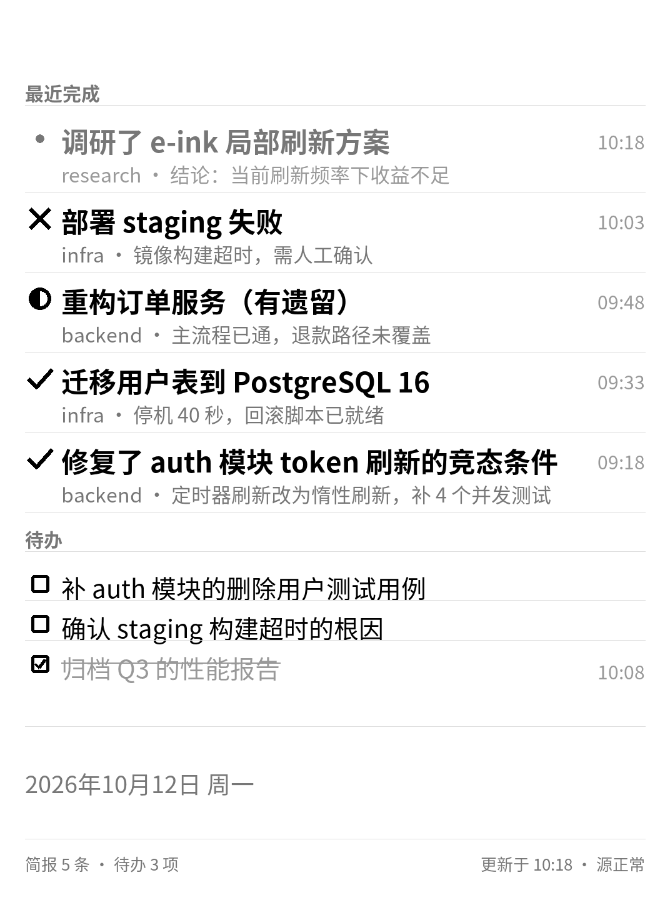
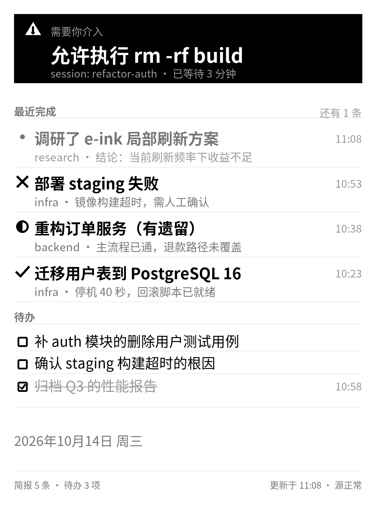
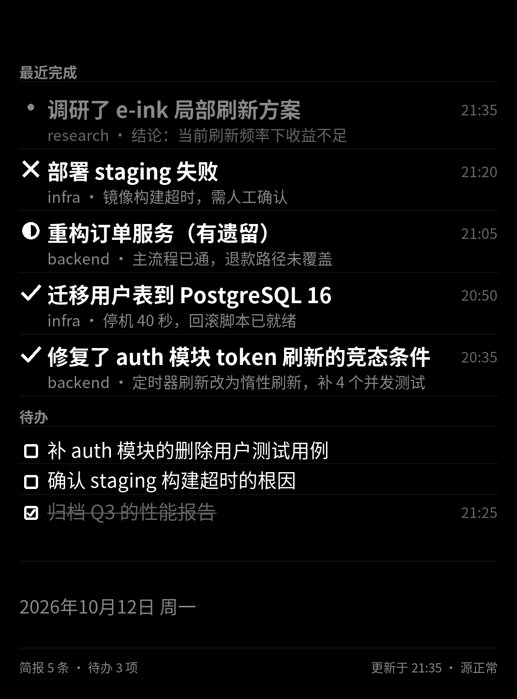
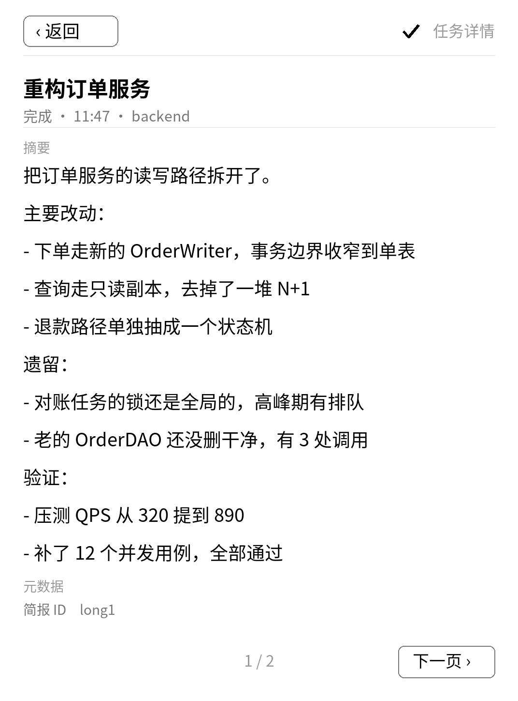

# kindlewarden

把 AI agent 的任务完成简报，推送到一块 Kindle 电子墨水副屏上。

不是「监控 agent 每一步在干什么」—— 那是主屏（终端）的事。
副屏只承载**结论**：完成了什么、需要你做什么、现在是什么情况。

```
不同终端 (DSH / Claude Code / Codex / …)
   │
   ├─ stdio MCP: warden-mcp          ← 瘦客户端
   │      └─ 写本地持久发件箱，立即返回
   │         后台线程异步投递（失败退避重试）
   │
   ▼
副屏 Host（常驻）
   ├─ HTTP 受件       POST /brief /todo /alert
   ├─ 事件溯源存储     append-only JSONL
   ├─ 投影 + 渲染      → 1072×1448 灰度 PNG
   └─ HTTP 分发       GET /rev  /screen.png  /screen.json
   │
   ▼
Kindle PW3（越狱 + KOReader 插件）
   └─ 拉 /rev，变了才取图          ← 设备只拉，服务端不推
```

**三条核心原则：**

1. **副屏永远不该影响主屏的工作。** agent 侧永远是本地写，host 挂了也完全无感。
2. **不变就不刷。** `rev` 只在画面真的变化时才变，这是省电模型的基础。
3. **看板不能说谎。** 显示的是「更新于 14:32」这种永远为真的快照事实，
   而不是「3 分钟前」这种会随时间变成假话的相对时间。

## 长什么样

| 看板（竖屏） | 有告警时 |
|---|---|
|  |  |

| 横屏模式 | 夜间模式 |
|---|---|
|  |  |

点任意一条简报进详情页（长内容自动分页）：



> 横屏与夜间都是**纯服务端**实现的（渲染完旋转 / 反色），
> 设备侧不需要任何更新 —— 改配置即时生效。
> 横屏的代价是 PW3 没有重力感应，**要物理转动设备**来看。

---

## 快速开始

```powershell
pip install -e ".[mcp]"

# 初始化配置（会写到 %LOCALAPPDATA%\kindlewarden\panels.toml）
python -m kindlewarden.cli init

# 启动常驻服务
python -m kindlewarden.cli serve

# 另一个终端：灌一组样例内容审版面
python -m kindlewarden.cli seed-demo

# 浏览器打开 http://127.0.0.1:8577/ 就能看到副屏
```

挂到 MCP 客户端（Claude Code 示例）：

```bash
claude mcp add kindlewarden -- python -m kindlewarden.mcp_server
```

**推荐：走 HTTP**（不用装东西，配置里就一个 URL）：

```json
{
  "mcpServers": {
    "kindlewarden": {
      "type": "http",
      "url": "http://<host>:8577/mcp"
    }
  }
}
```

服务端要带 `--mcp` 启动：

```bash
warden serve --mcp
```

| | stdio 瘦客户端 | HTTP |
|---|---|---|
| 配置 | 每个终端装一次，要填 exe 路径 | **一个 URL** |
| 发简报 | 写本地队列立即返回，后台异步投递 | **同步**，返回即已写入 |
| host 挂了 | agent **完全无感** | tool call 直接报错 |
| 跨机器 | 要各装一次 | 天然支持 |

> **取舍**：HTTP 更省事，但丢掉了「副屏永远不影响主屏」这条保证 ——
> host 重启或断网时，agent 会拿到错误。追求省事选 HTTP，
> 追求 agent 完全不受副屏影响选 stdio。

设置副屏服务地址（stdio 形态下 agent 在别的机器上时）：

```bash
KINDLEWARDEN_URL=http://192.168.1.50:8577
```

浏览器打开 **http://127.0.0.1:8577/** 就是管理控制台。

三个入口，用途不同：

| 地址 | 用途 | Kindle 上能开吗 |
|---|---|---|
| `/` | **管理控制台** —— 管简报/待办/告警/设置，点条目看详情 | ❌ 现代 SPA，老 WebKit 白屏 |
| `/kindle` | **纯画面页** —— 零 JavaScript，自动刷新 | ✅ **Kindle 上开这个** |
| `/view` | 桌面上的全屏预览 | ❌ 用了现代 JS |

---

## Docker 部署

不想在这台机器上装 Python 依赖、或者想把它丢到 NAS / 小主机上常驻：

```bash
git clone https://github.com/yszpatt/kindlewarden.git
cd kindlewarden

# ⚠️ 先把 docker-compose.yml 里的 KINDLEWARDEN_PUBLIC_HOST 改成
#    你这台机器的**局域网 IP**（见下）
docker compose up -d
```

控制台：**http://127.0.0.1:8577/** · MCP：**http://<宿主机IP>:8577/mcp**

> **镜像默认就开了 MCP。** 容器是跑 MCP 最省事的位置 ——
> 起一个，所有终端指过来就行，不用在每台机器上装东西、
> 也不用碰 exe 路径。客户端配置：
>
> ```json
> {"mcpServers": {"kindlewarden": {"type": "http",
>                                  "url": "http://192.168.1.50:8577/mcp"}}}
> ```

不用 compose 也行：

```bash
docker build -t kindlewarden .

docker run -d --name kindlewarden \
  -p 8577:8577 \
  -e KINDLEWARDEN_PUBLIC_HOST=192.168.1.50 \
  -v warden-data:/data \
  --restart unless-stopped \
  kindlewarden
```

### ⚠️ `KINDLEWARDEN_PUBLIC_HOST` 必须设对

它决定**两件事**，漏了都会出问题：

| 影响 | 不设的现象 |
|---|---|
| Kindle 该连哪个地址 | 「页面无法显示」，想不到是地址猜错 |
| **MCP 的 Host 校验** | `/mcp` 回 **421 Invalid Host header** |

MCP 那一条尤其难查：容器里自动探测到的是**容器自己的**地址
（`172.17.x.x`），而客户端连的是宿主机的 `192.168.x.x:8577` ——
Host 头对不上就被拒，报错里完全看不出"是地址没设"。

服务启动时如果检测到"在容器里但没设这个变量"，**会主动打印警告**。

可以写 `192.168.1.50`，也可以直接粘 `http://192.168.1.50:8577`，两种都认。

查宿主机的局域网 IP：

```bash
ipconfig            # Windows
ip route get 1.1.1.1    # Linux
ipconfig getifaddr en0  # macOS
```

### 数据放在哪

事件日志和 `panels.toml` 都在容器里的 `/data`，已挂成命名卷。

> **必须持久化。** 事件溯源存储就是全部真相 ——
> 卷丢了等于所有简报都没了。想看日志内容：
> `docker compose exec kindlewarden warden board`

### 镜像里为什么要装中文字体

渲染器要画中文。少了字体服务能起来，但**一渲染就报
「找不到可用的中文字体」**，而 Kindle 那边只是拉不到图 ——
现象和「网络不通」一模一样，很难查。

所以镜像装了 `fonts-noto-cjk`，并且**在构建时**就调真正的字体发现逻辑
把选中的字体打出来 —— 缺字体在构建阶段就炸，而不是等第一次渲染。

顺带这个容器也能干设备侧打包的活（它保留了源码布局）：

```bash
docker compose exec kindlewarden warden package --server http://192.168.1.50:8577
docker compose cp kindlewarden:/app/dist ./dist
```

---

## 在 Kindle 上访问

有两条路，取决于要不要越狱：

### 不越狱：自带浏览器

```
http://<host的局域网IP>:8577/kindle
```

地址可以在管理控制台预览图下方直接看到。
**必须是 `/kindle`**：Kindle 浏览器的老 WebKit 不支持 `let`/`const`
（脚本里一出现就整段不执行），不支持 `fetch`、CSS 变量、`display:grid` ——
管理控制台（`/`）在它上面必然白屏。`/kindle` 只有一个 `` 和一条
`<meta http-equiv="refresh">`。

浏览器方案的固有限制：工具栏占高度、Kindle 会休眠、前台耗电。
**适合"看一眼"，不适合常驻。**

### 越狱后：KOReader 插件（推荐）

```powershell
warden package --server http://<host的局域网IP>:8577
warden deploy
```

然后在 KOReader 里 **菜单 → 工具 → kindlewarden 副屏**。

| | 浏览器 | shell + fbink | **KOReader 插件** |
|---|---|---|---|
| 屏幕归属 | — | ❌ 盖在 framework 上 | ✅ **独占** |
| 抢屏 | — | ❌ 靠每 60 秒重绘去抢 | ✅ 不存在 |
| 触摸穿透 | — | ❌ 会打开底下的书 | ✅ 原生 |
| 点击看详情 | — | ❌ | ✅ |
| 随时退出 | ✅ | ⚠️ | ✅ 点「退出」按钮或滑动 |

> **为什么插件是唯一"对"的方案**：另外两条的问题都是架构性的。
> `fbink` 直接画 framebuffer，而 Kindle 的 Java framework 也在画同一个、
> **并且仍处理触摸** —— 所以只能靠重绘去抢，而且点屏幕必然穿透。
> KOReader 是全屏应用，这两件事天然成立。

> ⚠️ **退出方式：点右下角「退出 ✕」，或者往任意方向滑动屏幕。**
> 不要指望 Home 键或返回键 —— PW3 是纯触摸设备，KOReader 在
> `Device:hasKeys()` 为假时**不会注册 Home 键**，那个键在 Kindle 上不存在。
> 「退出」按钮是插件**自己画的**，所以服务端连不上、画面全白时它依然在。

插件不自己排版：服务端在返回 PNG 的同时给出每张卡片的矩形（`rect`），
插件只做一次坐标换算然后判断命中。**改版面只动服务端。**

---

## 管理控制台

`GET /` 是一个单文件、零外部依赖的控制台页面（**不引任何 CDN** ——
这台机器很可能没有外网，一个白屏的管理页比没有管理页更糟）。

| 能力 | 说明 |
|---|---|
| 实时预览 | 跟着 `rev` 走，画面没变就不重新拉图 |
| **简报列表 + 点击看详情** | 完整标题/摘要、产出物（可点链接）、元数据、钉住/撤回/以此为准发布更新 |
| 待办 | 增删改、勾选完成（**点文字直接原地编辑**） |
| 告警 | 挂起 / 清除 |
| 发布 | 手动发一条，带**显示宽度实时计数**（超了会告诉你板上会被截断） |
| 设置 | 板块开关、保留时长、时钟、天气、轮询间隔、**夜间/横屏** —— **保存即生效，不用重启** |
| 设备状态 | Kindle 最后拉取时间与 IP（只统计设备请求，不含管理页自己的轮询） |

详情页支持深链接：`http://<host>:8577/#b=<简报ID>`，可以直接分享或收藏。

另有 `/view` 是一个极简的全屏画面页，适合挂在第二个窗口里盯着。

### 夜间模式与横屏模式

两个都在**管理控制台 → 设置 → display** 里开关，**改完即生效**。

| 模式 | 效果 | 注意 |
|---|---|---|
| **夜间** | 反色（黑底白字），暗环境不刺眼 | 无 |
| **横屏** | 按宽>高排版，内容转 90° | **要物理转动设备**（PW3 没有重力感应） |

> **这两个功能完全在服务端实现，Kindle 侧不需要任何更新。**
>
> 原因是插件里 `IMG_W, IMG_H = 1072, 1448` 是硬编码的，服务端**必须**
> 始终交付这个尺寸 —— 这反而让两种模式都有了干净的实现：
> 夜间是渲染后反色（尺寸不变），横屏是先按 1448×1072 排版再转 90°
> （尺寸正好还是 1072×1448）。
>
> 代价是横屏时**退出按钮的文字是侧着的** —— 它是插件画的，
> 不经过服务端的旋转。这是"设备侧零改动"这个选择带来的固有限制。

---

> **为什么详情里能看到完整文本？**
> 简报是**存全文**的，截断只发生在**渲染时**（按像素宽度）。
> 早先的实现是在入库时就把标题截到 20 字、摘要截到 28 字 ——
> 那样完整内容在写进日志的同时就没了，详情功能根本无从谈起。
> 现在存储只做防滥用封顶，管理页会主动提示「这条在板上会被截断」。

---

## 常用命令

| 命令 | 作用 |
|---|---|
| `warden serve` | 启动常驻服务（含管理控制台） |
| `warden doctor` | **诊断「Kindle 连不上」** —— 检查监听地址、网卡、防火墙，并给出该填的地址 |
| `warden usb` | **诊断「插上电脑没反应」** —— 查 USB 枚举记录，分辨是线/口问题还是驱动/盘符问题 |
| `warden package --server http://…` | 打包 Kindle 侧（KOReader 插件 + shell 客户端） |
| `warden deploy` | 把打包产物部署到 Kindle（自动找盘符） |
| `warden preview` | **本地渲一张 PNG，不需要服务在跑** —— 用来反复调版面 |
| `warden publish "标题" --status ok --summary "摘要"` | 发一条简报 |
| `warden todo "要做的事"` | 新增待办 |
| `warden todo` | 列出待办（带 id） |
| `warden todo --edit <id> 新文字` | **修改**一条已有待办 |
| `warden todo --done <id>` / `--undone <id>` | 勾上 / 取消勾选 |
| `warden todo --remove <id>` | 删除 |
| `warden alert "需要确认"` / `warden alert --clear` | 需要人介入的告警 |
| `warden brief` | 列出简报（`--pin` / `--retract` 可操作） |
| `warden board --json` | 查看看板原始数据 |
| `warden seed-demo` | 灌样例内容审版面 |

> ⚠️ **`warden serve` 默认监听 `0.0.0.0`（所有网卡）。**
> 如果你加了 `--host 127.0.0.1`，本机测试一切正常，但 Kindle **永远连不上**，
> 而现象只是「页面无法显示」—— 极难定位。`warden doctor` 就是为这类问题准备的。

容器里跑同样的命令：

```bash
docker compose exec kindlewarden warden doctor
```

---

## 文档

| 文档 | 内容 |
|---|---|
| [架构设计](docs/architecture.md) | 系统结构、MCP 接口、板块系统、多终端策略、决策记录 |
| [版面规格](docs/layout-spec.md) | 画布、字号阶梯、分区计算、各板块设计（渲染器的实现依据） |
| [Kindle 部署手册](docs/kindle-deploy.md) | 越狱、KUAL、FBInk、客户端部署与排错 |
| [简报 skill](skills/kindle-brief/SKILL.md) | 教 agent「何时该发、何时不该发」 |
| [开发说明](docs/dev-notes.md) | 本地运行、测试、沙箱注意事项 |

早期讨论稿 [design.md](docs/design.md) 与
[architecture-deep-dive.md](docs/architecture-deep-dive.md) 保留作为决策过程记录，
其中的**技术核实结果仍然有效**，但架构结论已由 `architecture.md` 取代。

---

## 开发

```powershell
$env:PYTHONPATH = "$PWD;$PWD\.tools"
.\.tools\... # 见 docs/dev-notes.md
python -m pytest -q
```

设计稿里验证过的版面渲染器在 [`tools/mockup.py`](tools/mockup.py)，
它是 `kindlewarden/render.py` 的前身，保留作为版面迭代的快速试验场。
